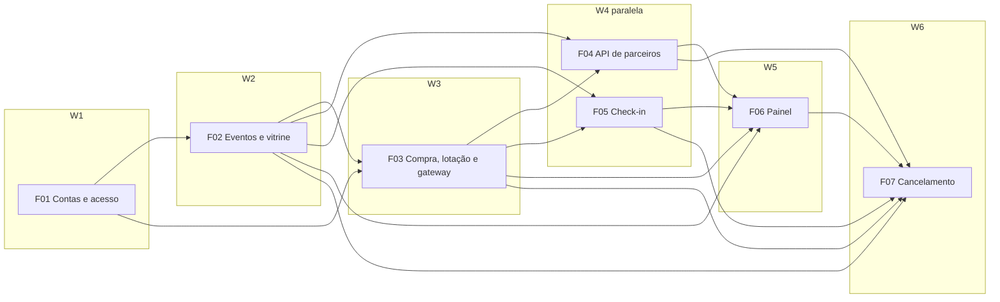

# PRD — Catraca (MVP)

> Referência de regras: [brief.md](brief.md) (cópia fiel do enunciado, R01–R13). Este PRD não reescreve as regras: ele as divide em features, liga as features entre si e fixa como cada regra será comprovada. Em conflito entre este PRD e o brief, vale o brief, e o PRD é corrigido.

Sumário

1. [Visão, personas e glossário](#1-visão-personas-e-glossário)
2. [Premissas técnicas](#2-premissas-técnicas)
3. [Features](#3-features)
4. [Grafo de dependências](#4-grafo-de-dependências)
5. [Waves](#5-waves)
6. [Critérios de aceite (W0 e features)](#6-critérios-de-aceite-w0-e-features)
7. [Critérios cross-feature](#7-critérios-cross-feature)
8. [Matrizes de rastreabilidade](#8-matrizes-de-rastreabilidade)
9. [Riscos e mitigação](#9-riscos-e-mitigação)
10. [Fora de escopo](#10-fora-de-escopo)
11. [Convenção de artefatos](#11-convenção-de-artefatos)
12. [Checklist de autoverificação](#12-checklist-de-autoverificação)

---

## 1. Visão, personas e glossário

### 1.1 Visão

A Catraca vende ingressos para eventos pequenos (shows em bar, workshops, meetups). O MVP cobre o ciclo inteiro de um evento: o organizador cria e publica, o participante (na vitrine) e o parceiro (pela API) compram um ingresso por vez, um gateway de pagamento simulado confirma ou recusa de forma assíncrona, o organizador faz o check-in na porta, acompanha o painel e, se preciso, cancela o evento.

O que define sucesso não é cada tela funcionar sozinha, e sim as regras continuarem verdadeiras quando as features se encontram: evento cancelado não deixa ninguém entrar, estorno não vira receita e a lotação nunca é ultrapassada, nem sob compras simultâneas.

### 1.2 Personas

| Persona | Como entra | O que faz no MVP |
|---|---|---|
| Visitante | sem login | Vê a vitrine de eventos publicados e não cancelados e o detalhe de cada um. Não compra, não acessa a área de organizador. |
| Participante | cria a própria conta (nome, e-mail, senha) e entra com e-mail e senha | Compra ingressos na vitrine, um por compra; vê evento, status e código em "Meus ingressos"; sai. |
| Organizador | conta criada pela seed (não há cadastro de organizador) | Na área de organizador, cria, edita, publica e cancela os próprios eventos; na página de gestão de cada evento faz o check-in e vê o painel. Só enxerga os próprios eventos. |
| Parceiro | sistema externo com o cabeçalho `X-Api-Key` | Lista eventos à venda, compra ingressos (sem conta de participante) e consulta qualquer ingresso pela API de parceiros. |

### 1.3 Glossário de status

**Status do ingresso.** A interface mostra o rótulo; a API e o banco usam o valor.

| Rótulo (interface) | Valor (API e banco) | Quando | Ocupa vaga? |
|---|---|---|---|
| pendente | `pending` | compra criada, aguardando a resposta do gateway | sim |
| confirmado | `confirmed` | o gateway aprovou | sim |
| recusado | `declined` | o gateway recusou | não |
| cancelado | `cancelled` | estava pendente quando o evento foi cancelado | não |
| estornado | `refunded` | estava confirmado quando o evento foi cancelado | não |

**Check-in não é status.** Ter passado pelo check-in é uma informação à parte: no banco, o campo `Ingresso.check_in_em` (data e hora, nulo enquanto não houve check-in); na API, o campo booleano `checkedIn`. Um ingresso confirmado com check-in continua `confirmed`.

**Status do evento** (decisão deste PRD; o brief só fixa os conceitos):

| Rótulo (interface) | Valor (banco) | Significado |
|---|---|---|
| Rascunho | `rascunho` | estado inicial; fora da vitrine e da API; não vende (R02) |
| Publicado | `publicado` | na vitrine e na API; vende enquanto houver vaga (R02) |
| Cancelado | `cancelado` | irreversível; fora da vitrine e da API; não vende, não edita, não republica (R11) |

**Outros termos.**

- **Vagas ocupadas**: ingressos `pending` + `confirmed` do evento (R05).
- **Vagas disponíveis**: lotação − vagas ocupadas; zero em evento cancelado (R05). Na API, `availableSeats`.
- **Página de gestão**: página da área de organizador com URL própria por evento, onde o organizador edita, publica, cancela, faz o check-in e vê o painel (R04).
- **Cobrança**: pedido ao gateway simulado gerado por uma compra; guarda o resultado sorteado pelo final do cartão e o momento em que a resposta "chega".
- **Canal**: por onde a compra entrou, `vitrine` ou `api`. Não muda nenhuma regra; serve para auditoria e testes.
- **Valor pago**: preço do evento gravado no ingresso no momento da compra (`Ingresso.valor_centavos`); base da Receita (R03, R12).

---

## 2. Premissas técnicas

Só o essencial; o detalhe fica nas specs de cada feature.

- **Stack.** Python gerenciado com uv (`pyproject.toml` e `uv.lock` versionados, versões fixadas), Django 5.2 LTS, PostgreSQL 17. Telas renderizadas no servidor com templates Django. Tudo roda em Docker Compose: `db` (Postgres), `web` (Django servindo telas e API) e `gateway` (worker do gateway simulado, container próprio). O avaliador só precisa de Docker, Git e Node LTS.
- **Camadas no mesmo projeto e processo.**
  - app `dominio`: modelos e serviços com as regras R01–R13, um módulo de serviço por assunto (`dominio/servicos/contas.py`, `eventos.py`, `compras.py`, `gateway.py`, `checkin.py`, `painel.py`, `cancelamento.py`);
  - app `web`: telas Django (vitrine, contas, Meus ingressos, área do organizador, página de gestão);
  - app `api_parceiros`: views JSON simples, sem DRF, seguindo o contrato fixo.
  - O modelo de usuário (`dominio.Usuario`, o `AUTH_USER_MODEL`) e a seed nascem na W0, na migration inicial, antes de qualquer feature: trocar o `AUTH_USER_MODEL` depois da primeira migration quebra bancos existentes (`InconsistentMigrationHistory`) nas worktrees e nas sessões de avaliação.
  - Web e API só chamam serviços do domínio. Nenhuma regra de negócio fica em view ou template; erros de regra saem do domínio como exceções (`EventoNaoEncontrado`, `EventoIndisponivel`, `IngressosEsgotados`, `CartaoInvalido`, `EventoCancelado`, `ValidacaoError`) que cada camada traduz para a sua resposta.
- **Lotação (R05, R07).** As vagas ocupadas (pendentes + confirmados) são contadas dentro de uma transação que trava a linha do evento (`SELECT … FOR UPDATE`). Na mesma transação, com a linha travada, o serviço confere se o evento ainda está à venda (publicado e não cancelado), conta as ocupadas, compara com a lotação e só então cria o ingresso. Editar lotação e cancelar o evento usam a mesma trava, então compra, edição e cancelamento do mesmo evento são serializados.
- **Preço (R03, R12).** O preço vigente é gravado no ingresso (`valor_centavos`) no momento da compra. Dinheiro sempre em centavos inteiros.
- **Gateway (R08, R11).** A resposta do gateway só muda o ingresso se ele ainda estiver pendente: `UPDATE … SET status=… WHERE id=… AND status='pending'`. O cancelamento é síncrono: na mesma transação que trava o evento, muda o status do evento e passa `confirmed → refunded` e `pending → cancelled`. Resposta que chega depois encontra o ingresso fora de `pending` e não muda nada.
- **Gateway simulado.** Resultado e atraso definidos pelo final do cartão, conforme a tabela do brief. O atraso é configurável só para testes (variável `GATEWAY_FATOR_ATRASO`, ausente no modo padrão), sem alterar o modo padrão, que é o do avaliador. O cartão nunca é gravado inteiro: só os 4 últimos dígitos. Nenhuma chave de pagamento real existe no projeto.
- **Endereços.** `$WEB` e `$API` são o mesmo servidor, `http://localhost:8000`; a API fica sob `/api/partner/`. Fuso `America/Sao_Paulo`; `startsAt` sai em ISO 8601 com offset (`-03:00`).

---

## 3. Features

### 3.1 Tabela de features

| ID | Nome | Objetivo | Regras | Provides (resumo) | Consumes |
|---|---|---|---|---|---|
| F01 | Contas e acesso | Participante se cadastra, entra e sai; área de organizador protegida (organizadores vêm da seed da W0) | R13 (participante e visitante); base de R06 e R09 | `cadastrar_participante`; guardas `organizador_requerido` e `participante_requerido`; `/contas/cadastro/`, `/contas/entrar/`, `/contas/sair/`, `/organizador/`; bloco `#usuario-logado` | W0 (`Usuario`, `seed`) |
| F02 | Eventos e vitrine | Organizador cria, edita e publica rascunhos; página de gestão com URL própria; só vê os próprios eventos; vitrine pública | R01, R02, R04, R13 | modelo `Evento`; `criar_evento`, `editar_evento`, `publicar_evento`, `eventos_do_organizador`, `evento_do_organizador`, `eventos_a_venda`, `evento_a_venda`; vitrine `/` e `/eventos/<id>/`; página de gestão `/organizador/eventos/<id>/` com slots `#check-in` e `#painel` | F01 |
| F03 | Compra, lotação e gateway | Compra de um ingresso, nasce pendente, ocupa vaga, nunca passa da lotação; gateway simulado + worker; Meus ingressos; preço gravado; lotação não fica abaixo das ocupadas | R03, R05, R06, R07, R08, R09; base de R11 e R12 | modelos `Ingresso` (com `check_in_em`) e `CobrancaGateway`; `comprar_ingresso`, `vagas_ocupadas`, `vagas_disponiveis`, `aplicar_resposta_gateway`, `ingressos_do_participante`, `consultar_ingresso`; trava de lotação em `editar_evento`; worker `gateway_worker`; `/eventos/<id>/comprar/`, `/meus-ingressos/`, bloco `#compra` | F01, F02 |
| F04 | API de parceiros | As três rotas do contrato fixo, `X-Api-Key`, erros na ordem 401 > 422 > 404 > 409, reutilizando a compra do domínio | R02, R05, R06, R07 (canal API) | `GET /api/partner/events`, `POST /api/partner/events/{eventId}/purchases`, `GET /api/partner/tickets/{ticketId}`; `exigir_chave_parceiro`; `scripts/rajada-api.sh` | F02, F03 |
| F05 | Check-in | As cinco mensagens exatas de R10, na ordem; check-in atômico | R10, R04, R13 | `fazer_check_in` → `ResultadoCheckIn`; bloco `#check-in` com `#check-in-mensagem`; `POST /organizador/eventos/<id>/check-in/` | F02, F03 |
| F06 | Painel | Os seis números de R12, contando vendas da vitrine e da API | R12, R04, R05, R13 | `painel_do_evento` → `Painel`; bloco `#painel` com `data-metrica` | F02, F03, F04, F05 |
| F07 | Cancelamento | Cancelamento irreversível: sai da vitrine e da API, não edita nem republica, confirmados → estornados, pendentes → cancelados, resposta tardia do gateway não muda nada | R11, R02, R05, R13 | `cancelar_evento`; bloqueio de `editar_evento`/`publicar_evento` em cancelado; bloco `#evento-cancelar`; `POST /organizador/eventos/<id>/cancelar/` | F02, F03, F04, F05, F06 |

**W0 — Harness (pré-requisito, não é feature de produto).** Provê:
- projeto Django com os três apps (`dominio`, `web`, `api_parceiros`) e o Compose (`db`, `web`, `gateway`);
- modelo `dominio.Usuario` na migration inicial: é o `AUTH_USER_MODEL`, login por e-mail, `email` (único), `nome`, `papel` ∈ {`participante`, `organizador`}, senha com hash do Django;
- comando `python manage.py seed` real e idempotente, que cria ou atualiza organizador A, organizador B e o participante, chamado pela subida; as credenciais de desenvolvimento são definidas na W0 e publicadas no README;
- `./scripts/up.sh`, `./scripts/down.sh` e `./scripts/gates.sh`; porta web configurável por variável de ambiente (padrão 8000);
- AGENTS.md (com CLAUDE.md apontando para ele) e `estado.json`.

A W0 não tem spec, contrato nem relatório de avaliação: seus critérios H-01…H-08 (seção 6.0) são verificados pela sessão de orientação.

### 3.2 Provides e Consumes detalhados

Os nomes abaixo são o acordo entre features: quem consome pode contar com eles exatamente assim. Mudança de nome exige atualizar este PRD e os contratos afetados.

#### F01 — Contas e acesso

Provides:
- Serviço `dominio.servicos.contas.cadastrar_participante(nome, email, senha) -> Usuario` (sempre `papel=participante`).
- Guardas `web.acesso.organizador_requerido` (visitante → 302 para `/contas/entrar/?next=…`; autenticado sem papel organizador → 403 sem dados) e `web.acesso.participante_requerido` (visitante → 302 para login).
- URLs: `/contas/cadastro/`, `/contas/entrar/`, `/contas/sair/` (POST), `/organizador/` (esqueleto da área de organizador, lista vazia até a F02).
- Bloco `#usuario-logado` no template base (nome do usuário e botão Sair) e link "Meus ingressos" para participante.

Consumes: W0 (`dominio.Usuario` com `papel`; comando `seed` com organizador A, organizador B e participante; projeto Django e Postgres). A F01 não altera o modelo de usuário nem a seed; o F01-CA05 confere a seed como verificação.

#### F02 — Eventos e vitrine

Provides:
- Modelo `dominio.Evento`: `id_publico` (string `evt_` + 8 caracteres, única; é o id da URL e da API), `organizador` (FK `Usuario`), `nome`, `inicio` (data e hora com fuso), `local`, `lotacao` (inteiro ≥ 1), `preco_centavos` (inteiro > 0), `status` ∈ {`rascunho`, `publicado`, `cancelado`}, `criado_em`.
- Serviços em `dominio.servicos.eventos`:
  - `criar_evento(organizador, dados) -> Evento` (nasce `rascunho`; valida R01);
  - `editar_evento(organizador, evento_id, dados) -> Evento` (valida R01; trava a linha do evento; ponto de extensão para a F03 e a F07);
  - `publicar_evento(organizador, evento_id) -> Evento` (só a partir de `rascunho`);
  - `eventos_do_organizador(organizador) -> QuerySet[Evento]`;
  - `evento_do_organizador(organizador, evento_id) -> Evento` (lança `EventoNaoEncontrado` se não existe ou é de outro organizador — as views traduzem para 404);
  - `eventos_a_venda() -> QuerySet[Evento]` (status `publicado`; cancelado e rascunho ficam fora);
  - `evento_a_venda(evento_id) -> Evento` (lança `EventoIndisponivel`).
- URLs e blocos:
  - vitrine `/` (lista `#vitrine` com nome, data e hora, local e preço) e detalhe `/eventos/<id>/` com o slot `#compra` (vazio até a F03);
  - `/organizador/` lista "Meus eventos" com o status de cada um;
  - `/organizador/eventos/novo/`;
  - página de gestão `/organizador/eventos/<id>/` com `#evento-dados`, `#evento-acoes` (editar; publicar quando rascunho) e os slots vazios `#evento-cancelar` (F07), `#check-in` (F05) e `#painel` (F06), cada um em um template parcial próprio;
  - `/organizador/eventos/<id>/editar/`, `/organizador/eventos/<id>/publicar/` (POST).

Consumes: W0 (`Usuario` com `papel`, contas da seed), F01 (`organizador_requerido`, `/organizador/`).

#### F03 — Compra, lotação e gateway

Provides:
- Modelo `dominio.Ingresso`: `id_publico` (`tkt_` + 8 caracteres, única), `codigo` (8 caracteres maiúsculos, único), `evento` (FK), `comprador` (FK `Usuario`, nulo em compras da API), `email_comprador`, `canal` ∈ {`vitrine`, `api`}, `status` ∈ {`pending`, `confirmed`, `declined`, `cancelled`, `refunded`} com os rótulos do glossário, `valor_centavos`, `cartao_final` (4 dígitos), `check_in_em` (nulo; o campo nasce aqui e só a F05 o preenche), `criado_em`.
- Modelo `dominio.CobrancaGateway`: `ingresso` (1-1), `resultado` ∈ {`aprovado`, `recusado`}, `responder_em`, `processada_em` (nulo até o worker processar).
- Serviços em `dominio.servicos.compras`:
  - `vagas_ocupadas(evento) -> int` e `vagas_disponiveis(evento) -> int` (zero se cancelado);
  - `comprar_ingresso(evento_id, *, cartao, email_comprador, canal, comprador=None) -> Ingresso` — valida o cartão antes de tudo, trava o evento, confere se está à venda, conta ocupadas, cria ingresso `pending` com `valor_centavos` = preço vigente e a cobrança; lança `CartaoInvalido`, `EventoIndisponivel` ou `IngressosEsgotados`;
  - `ingressos_do_participante(usuario)`;
  - `consultar_ingresso(ticket_id) -> Ingresso` (lança `IngressoNaoEncontrado`);
  - extensão de `editar_evento`: rejeita lotação menor que `vagas_ocupadas` com o evento travado.
- Serviços em `dominio.servicos.gateway`: `GatewaySimulado` (`resultado_para(cartao)`, `atraso_para(cartao)`), `aplicar_resposta_gateway(ingresso_id, aprovado) -> bool` (UPDATE condicional a `pending`; `False` quando não mudou nada), `processar_cobrancas_vencidas()`.
- Comando `python manage.py gateway_worker` (laço que processa cobranças vencidas) rodando no serviço `gateway` do Compose.
- URLs e blocos: `POST /eventos/<id>/comprar/`; bloco `#compra` no detalhe (formulário de cartão ou o texto **Ingressos esgotados**); `/meus-ingressos/` com a tabela `#meus-ingressos` (evento, status pelo rótulo, código).

Consumes: W0 (`Usuario`), F01 (`participante_requerido`, participante autenticado), F02 (`Evento`, `evento_a_venda`, `editar_evento`, slot `#compra`).

#### F04 — API de parceiros

Provides:
- `GET /api/partner/events`, `POST /api/partner/events/{eventId}/purchases`, `GET /api/partner/tickets/{ticketId}`, exatamente como no contrato fixo do brief.
- `api_parceiros.auth.exigir_chave_parceiro` (decorador; compara `X-Api-Key` com a configuração `CATRACA_CHAVE_PARCEIRO`, cujo valor de teste fica no Compose e no README).
- Serializadores `evento_para_api(evento)` e `ingresso_para_api(ingresso)` (`checkedIn = check_in_em is not None`).
- `scripts/rajada-api.sh`: cria eventos novos de lotação 5, dispara a rajada do passo 15 e falha se alguma rodada não der exatamente 5×202 e 25×409.

Consumes: F02 (`eventos_a_venda`, `Evento.id_publico`), F03 (`comprar_ingresso`, `vagas_disponiveis`, `consultar_ingresso`, campos de `Ingresso`, worker do gateway).

#### F05 — Check-in

Provides:
- `dominio.servicos.checkin.fazer_check_in(organizador, evento_id, codigo) -> ResultadoCheckIn`, enum com as cinco mensagens exatas de R10, avaliadas na ordem; trava o ingresso (`SELECT … FOR UPDATE`) e grava `check_in_em` uma única vez.
- Bloco `#check-in` (parcial da página de gestão) com campo do código e a mensagem em `#check-in-mensagem`; `POST /organizador/eventos/<id>/check-in/`.

Consumes: F02 (`evento_do_organizador`, slot `#check-in`, `Evento.status`), F03 (`Ingresso.codigo`, `status`, `check_in_em`).

#### F06 — Painel

Provides:
- `dominio.servicos.painel.painel_do_evento(evento) -> Painel` com `confirmados`, `pendentes`, `check_ins`, `vagas_disponiveis`, `receita_centavos`, `estornados`.
- Bloco `#painel` (parcial da página de gestão) com os rótulos Confirmados, Pendentes, Check-ins, Vagas disponíveis, Receita e Estornados; cada valor num elemento `data-metrica` ∈ {`confirmados`, `pendentes`, `check-ins`, `vagas-disponiveis`, `receita`, `estornados`}; receita no formato `R$ 350,00`.

Consumes: F02 (página de gestão, slot `#painel`), F03 (`Ingresso.status`, `valor_centavos`, `vagas_disponiveis`), F04 (ingressos `canal=api` criados pela API, que precisam entrar nos números), F05 (`check_in_em` preenchido por `fazer_check_in`).

#### F07 — Cancelamento

Provides:
- `dominio.servicos.cancelamento.cancelar_evento(organizador, evento_id) -> Evento`: só de `publicado`; numa transação que trava o evento, grava `status=cancelado` e passa `confirmed → refunded` e `pending → cancelled`.
- Bloqueio em `editar_evento` e `publicar_evento`: evento cancelado lança `EventoCancelado` ("Evento cancelado não pode ser alterado.").
- Bloco `#evento-cancelar` (botão com confirmação, só em evento publicado) e `POST /organizador/eventos/<id>/cancelar/`; página de gestão de evento cancelado sem editar e sem publicar.

Consumes: F02 (`Evento.status`, `editar_evento`, `publicar_evento`, vitrine, página de gestão), F03 (`Ingresso`, `aplicar_resposta_gateway` condicional, `vagas_disponiveis`), F04 (listagem e compra da API, que precisam refletir o cancelamento), F05 (caminho "Evento cancelado" do check-in), F06 (painel, que precisa mostrar estornos sem contá-los como receita).

### 3.3 Refinamentos em relação ao ponto de partida

- **`Ingresso.check_in_em` nasce na F03, não na F05.** A F04 precisa expor `checkedIn` e não pode depender da F05, senão a W4 deixa de ser paralela. A F05 só preenche o campo.
- **Usuário customizado e seed ficam na W0, não na F01.** O `AUTH_USER_MODEL` precisa existir na migration inicial; criá-lo numa feature depois de haver migrations quebra os bancos das worktrees e das sessões de avaliação (`InconsistentMigrationHistory`). Com a seed na W0, toda feature já sobe com organizador A, organizador B e participante. A F01 fica com cadastro, entrar, sair, guardas e `#usuario-logado`.
- **A F02 cria os slots da página de gestão** (`#evento-cancelar`, `#check-in`, `#painel`) como parciais vazias, e o domínio tem um módulo de serviço por feature. Assim F05, F06 e F07 editam arquivos próprios e os conflitos de merge da wave paralela ficam restritos ao roteamento.
- **Aresta F04 → F06 é de integração, não de código.** O painel não chama a API, mas o critério "compras pela API contam no painel" só é verificável depois da F04; por isso F06 fica numa wave posterior.

---

## 4. Grafo de dependências



Arestas (provedora → consumidora: o que é provido) e o critério cross que a cobre:

| # | Aresta | O que é provido | Critério cross |
|---|---|---|---|
| A01 | F01 → F02 | `organizador_requerido`, `/organizador/` | XF-01 |
| A02 | F01 → F03 | `participante_requerido`, participante autenticado, `#usuario-logado` | XF-02 |
| A03 | F02 → F03 | `Evento`, `evento_a_venda`, `editar_evento`, slot `#compra` | XF-03, XF-04 |
| A04 | F02 → F04 | `eventos_a_venda`, `Evento.id_publico` | XF-05 |
| A05 | F03 → F04 | `comprar_ingresso`, `vagas_disponiveis`, `consultar_ingresso`, worker do gateway | XF-06 |
| A06 | F02 → F05 | `evento_do_organizador`, slot `#check-in`, `Evento.status` | XF-07 |
| A07 | F03 → F05 | `Ingresso.codigo`, `status`, `check_in_em` | XF-08 |
| A08 | F02 → F06 | página de gestão, slot `#painel`, lotação editável | XF-09 |
| A09 | F03 → F06 | `Ingresso.status`, `valor_centavos`, `vagas_disponiveis` | XF-10 |
| A10 | F04 → F06 | ingressos `canal=api` | XF-11, XF-13 |
| A11 | F05 → F06 | `check_in_em` preenchido por `fazer_check_in` | XF-12, XF-13 |
| A12 | F02 → F07 | `Evento.status`, `editar_evento`, `publicar_evento`, vitrine, página de gestão | XF-14 |
| A13 | F03 → F07 | `Ingresso`, `aplicar_resposta_gateway` condicional, `vagas_disponiveis` | XF-15 |
| A14 | F04 → F07 | listagem, compra e consulta da API | XF-16, XF-19 |
| A15 | F05 → F07 | caminho "Evento cancelado" de `fazer_check_in` | XF-17, XF-19 |
| A16 | F06 → F07 | `painel_do_evento` | XF-18, XF-19 |

Não há aresta entre F04 e F05. A W0 não aparece no grafo porque não é feature: todas as features a consomem (`Usuario`, `seed`, Compose e scripts).

---

## 5. Waves

| Wave | Features | Pré-requisito | Modo |
|---|---|---|---|
| W0 | Harness (não é feature): projeto, Compose, scripts, `Usuario` na migration inicial, `seed` real, AGENTS.md, `estado.json` | — | sequencial; verificada pela orientação (H-01…H-08) |
| W1 | F01 | W0 | sequencial |
| W2 | F02 | W1 | sequencial |
| W3 | F03 | W2 | sequencial |
| W4 | F04 ∥ F05 | W3 | **paralela**: uma branch e uma worktree por feature, ao mesmo tempo, integradas à main por PRs |
| W5 | F06 | W4 | sequencial |
| W6 | F07 | W5 | sequencial |

**Por que a W4 é paralelizável.** F04 e F05 só consomem serviços do domínio já entregues por F02 (`eventos_a_venda`, `evento_do_organizador`, página de gestão) e F03 (`comprar_ingresso`, `vagas_disponiveis`, `consultar_ingresso`, campos de `Ingresso`, inclusive `check_in_em`). Nenhuma das duas consome nada da outra, então não há aresta entre elas. Também mexem em lugares diferentes: a F04 em `api_parceiros/`, a F05 em `dominio/servicos/checkin.py` e no parcial `#check-in` de `web/`. O ponto provável de conflito é o roteamento (`urls.py`) e o `estado.json`, resolvidos no merge do segundo PR. A combinação das duas (ingresso comprado pela API passando no check-in) é provada depois, em F06 (XF-13) e F07 (XF-19).

Uma feature de wave posterior só começa com todas as provedoras aprovadas pelo avaliador e mergeadas na main.

---

## 6. Critérios de aceite (W0 e features)

Convenções: textos entre aspas são exatos (comparação de string). "Gestão de E" é `/organizador/eventos/<id de E>/`. Tempos do gateway valem no modo padrão (sem `GATEWAY_FATOR_ATRASO`), salvo quando o critério diz o contrário. Cada critério é verificável por comando (pytest, curl, consulta ao banco) ou por efeito observável na interface.

### 6.0 W0 — critérios de harness

Verificados pela sessão de orientação, sem contrato nem relatório. Todos os comandos rodam a partir da raiz do clone, com Docker, Git e Node LTS no host e nada mais.

| ID | Critério | Como verificar |
|---|---|---|
| H-01 | Em clone limpo, `./scripts/up.sh` sobe tudo com a seed carregada, sem outro passo, e `$WEB` responde. | `git clone` em pasta vazia; `./scripts/up.sh`; `curl -s -o /dev/null -w "%{http_code}" $WEB/` → 200; entrar com organizador A, organizador B e participante do README. |
| H-02 | `./scripts/down.sh` encerra tudo que a subida iniciou: nenhum container do projeto rodando e a porta do produto sem resposta. Os dados do banco são mantidos (volume nomeado). | `./scripts/down.sh`; `docker ps --filter label=com.docker.compose.project=<projeto>` vazio; `curl $WEB/` falha na conexão; `docker volume ls` ainda lista o volume do banco. |
| H-03 | `down` e `up` de novo sobem sem erro, a seed roda de novo sem erro e as credenciais continuam funcionando. | `./scripts/down.sh && ./scripts/up.sh` com código 0; log da seed sem erro; login com as três contas do README; eventos criados antes continuam lá. |
| H-04 | `./scripts/gates.sh` roda lint, checagem do Django, checagem de migrations pendentes e pytest, tudo em container, sem Python no host, e sai com código ≠ 0 se algo falhar. | Rodar na main → código 0, com a saída de cada etapa; introduzir uma falha proposital (teste quebrado, migration faltando) → código ≠ 0. |
| H-05 | O modo padrão sobe sem nenhuma chave de pagamento e sem `.env`; os valores de desenvolvimento ficam no `compose.yaml`. | Clone limpo sem `.env` sobe (H-01) e uma compra com final 0001 confirma; `grep` no `compose.yaml` mostra os valores de desenvolvimento e nenhuma variável de gateway real. |
| H-06 | AGENTS.md na raiz com os comandos, as regras do projeto e o mapa dos artefatos; CLAUDE.md aponta para ele. | Leitura dos dois arquivos: AGENTS.md cita `up.sh`, `down.sh`, `gates.sh`, as regras de camada e o mapa `docs/…` e `estado.json`; CLAUDE.md remete ao AGENTS.md. |
| H-07 | Porta web configurável por variável de ambiente (padrão 8000), para duas worktrees subirem ao mesmo tempo. | Sem a variável, `$WEB` = `http://localhost:8000`; numa segunda worktree, subir com outra porta e as duas respondem ao mesmo tempo. |
| H-08 | O servidor web atende ao menos 30 requisições simultâneas (servidor de aplicação com workers/threads e conexões do Postgres suficientes). | 30 `curl` paralelos (`xargs -P 30`) em `$WEB/` respondem todos 200, sem erro de conexão nem timeout; configuração de workers/threads e `max_connections` visível no `compose.yaml`. |

### F01 — Contas e acesso

- **F01-CA01** — Cadastro. `GET /contas/cadastro/` mostra campos nome, e-mail e senha. `POST` válido cria um `Usuario` com `papel=participante`, senha com hash (a senha em texto não aparece em nenhuma coluna do banco), inicia a sessão e redireciona para a vitrine com o nome do usuário em `#usuario-logado`.
- **F01-CA02** — Cadastro inválido. E-mail já cadastrado, e-mail mal formado ou campo vazio reexibe o formulário com erro, e a contagem de usuários não muda.
- **F01-CA03** — (R13) O cadastro nunca cria organizador: `POST` com campo extra `papel=organizador` cria participante, e essa conta recebe 403 em `/organizador/`.
- **F01-CA04** — Entrar e sair. Credenciais válidas em `/contas/entrar/` iniciam a sessão; inválidas mostram "E-mail ou senha inválidos." sem sessão. `POST /contas/sair/` encerra a sessão: em seguida `GET /organizador/` com o mesmo cookie responde 302 para o login.
- **F01-CA05** — Seed (provida pela W0, verificada aqui). `python manage.py seed` rodado duas vezes seguidas termina com código 0 nas duas; existem exatamente uma conta de cada (organizador A, organizador B, participante), com os papéis corretos, e as três entram com as credenciais do README.
- **F01-CA06** — (R13) Guarda da área de organizador. `GET /organizador/`: visitante → 302 para `/contas/entrar/?next=/organizador/`; participante → 403 sem dados de evento; organizador → 200. Um teste percorre todas as rotas registradas sob `/organizador/` e confirma 302 para visitante e 403 para participante em cada uma (protege as rotas que as próximas features criarem).

### F02 — Eventos e vitrine

- **F02-CA01** — (R01, R02) Criar evento. Organizador informa nome, data e hora de início no futuro, local, lotação 2 e preço "100,00": o evento é gravado com `status=rascunho`, `preco_centavos=10000`, `organizador` = usuário logado, `id_publico` no formato `evt_…`, e o navegador vai para a gestão do evento. O preço aceita "100", "100,00" e "100.00", e os três viram 10000 centavos.
- **F02-CA02** — (R01) Validações. Início no passado (ex.: ontem) é rejeitado ao criar e ao editar, com mensagem no formulário e nada gravado; lotação 0, negativa ou não inteira é rejeitada; preço com texto não numérico, zero ou negativo é rejeitado; campo obrigatório vazio é rejeitado.
- **F02-CA03** — (R02) Rascunho fica fora. Evento em rascunho não aparece em `/` nem em `eventos_a_venda()`; `GET /eventos/<id>/` de rascunho responde 404 para visitante e participante.
- **F02-CA04** — (R02) Publicar. `POST /organizador/eventos/<id>/publicar/` em rascunho grava `status=publicado`; o evento passa a aparecer em `/` (deslogado) e em `eventos_a_venda()`. Publicar de novo não muda nada.
- **F02-CA05** — (R04) Página de gestão. `/organizador/eventos/<id>/` abre diretamente pela URL (inclusive após sair e entrar de novo) e contém `#evento-dados` (nome, início, local, lotação, preço "R$ 100,00", status pelo rótulo), `#evento-acoes` (editar; publicar só em rascunho) e os slots `#evento-cancelar`, `#check-in` e `#painel`.
- **F02-CA06** — (R01, R03) Editar. Alterar nome, local, início (futuro), preço e aumentar a lotação é aceito e aparece na gestão e na vitrine.
- **F02-CA07** — (R13) Lista do organizador. `/organizador/` mostra só os eventos do organizador logado: A não vê eventos de B e vice-versa.
- **F02-CA08** — (R13) Evento de outro organizador. B faz `GET` na gestão e no editar de um evento de A e `POST` em editar e publicar: todas as respostas são 404, o corpo não contém nome, local, lotação nem preço do evento, e o banco não muda.
- **F02-CA09** — (R02) Vitrine pública. Sem login, `/` lista os eventos publicados e não cancelados com nome, data e hora, local e preço, ordenados pelo início; cada um leva a `/eventos/<id>/`.

### F03 — Compra, lotação e gateway

- **F03-CA01** — (R06, R09) Compra na vitrine. Participante logado, no detalhe de um evento publicado, informa o cartão `4000000000000001`: o ingresso é criado `pending`, a resposta HTTP chega em menos de 1 s (não espera o gateway) e o navegador vai para `/meus-ingressos/`, que mostra o nome do evento, o status "pendente" e o código.
- **F03-CA02** — (R08) Aprovação. Com final `0001`, o ingresso fica `confirmed` e "confirmado" em Meus ingressos em até 5 s após a compra (recarregando a página).
- **F03-CA03** — (R05, R08) Recusa libera vaga. Com final `0002` e com um final fora da tabela (ex.: `4000000000000009`), o ingresso fica `declined` ("recusado") em até 5 s e `vagas_disponiveis` volta ao valor anterior à compra.
- **F03-CA04** — (R05, R06) Pendente ocupa vaga. Evento com lotação 1, compra com final `0004` (recusado e lento): enquanto o ingresso está pendente, `vagas_disponiveis` é 0 e o detalhe do evento exibe "Ingressos esgotados"; depois da recusa (entre 32 e 38 s, sempre antes de 45 s) a vaga volta e o formulário reaparece. Com final `0003` (aprovado e lento), o ingresso continua pendente aos 30 s e fica confirmado antes de 45 s.
- **F03-CA05** — (R07) Esgotado na vitrine. Sem vaga disponível, o bloco `#compra` exibe "Ingressos esgotados" no lugar do formulário; um `POST /eventos/<id>/comprar/` enviado mesmo assim exibe "Ingressos esgotados" e não cria ingresso.
- **F03-CA06** — (R07) Concorrência. Teste pytest contra o Postgres do Compose: 30 threads liberadas juntas (barreira) chamam `comprar_ingresso` no mesmo evento de lotação 5 → exatamente 5 ingressos criados e 25 `IngressosEsgotados`; o teste repete em 10 eventos novos e, em todos, `vagas_ocupadas` termina em 5.
- **F03-CA07** — Cartão. Número com quantidade de dígitos diferente de 16 ou com não dígitos é rejeitado com mensagem antes de criar o ingresso (contagem de ingressos e cobranças não muda). Depois de compras com `4000000000000001`, nenhuma coluna de nenhuma tabela contém o número inteiro; o ingresso guarda só `0001`.
- **F03-CA08** — (R09) Código e Meus ingressos. `Ingresso.codigo` tem restrição de unicidade no banco e 8 caracteres maiúsculos; o participante vê em `/meus-ingressos/` todos os próprios ingressos e nenhum ingresso de outro participante.
- **F03-CA09** — (R03) Lotação × ocupadas. Com 2 vagas ocupadas, editar a lotação para 1 é rejeitado com a mensagem "A lotação não pode ser menor que as vagas ocupadas (2)." e o evento não muda; lotação 2 ou 3 é aceita. A checagem acontece com a linha do evento travada.
- **F03-CA10** — (R03, R12) Preço gravado. Ingresso comprado com preço R$ 100,00 tem `valor_centavos=10000`; após mudar o preço para R$ 150,00, esse ingresso continua com 10000 e a compra seguinte grava 15000.
- **F03-CA11** — (R08) Tempos do gateway. No modo padrão, finais `0001`, `0002` e fora da tabela respondem com atraso sorteado entre 2 e 4 s; `0003` e `0004`, entre 32 e 38 s (testes unitários do sorteio com semente). O Compose do avaliador não define `GATEWAY_FATOR_ATRASO`; quando definido (só em testes), apenas multiplica o atraso.
- **F03-CA12** — (R08, R11) Resposta condicional. `aplicar_resposta_gateway` em ingresso que não está `pending` (`confirmed`, `declined`, `cancelled`, `refunded`) não muda nada e retorna `False`; a cobrança é marcada como processada mesmo assim.
- **F03-CA13** — (R02, R06) Evento indisponível. `POST /eventos/<id>/comprar/` para evento em rascunho ou id inexistente responde 404 e não cria ingresso.
- **F03-CA14** — Worker resiliente. O worker roda no serviço `gateway` do Compose, em container próprio. Com cobranças pendentes, derrubar e subir de novo não deixa ingresso pendente para sempre: depois da subida, as cobranças vencidas são processadas.

### F04 — API de parceiros

- **F04-CA01** — (R02, R05) Listagem. `GET /api/partner/events` com a chave → 200, array JSON; cada item tem exatamente `id` (string `evt_…`), `name`, `startsAt` (ISO 8601 com offset), `priceCents` (inteiro) e `availableSeats` (= `vagas_disponiveis`); só aparecem eventos publicados e não cancelados.
- **F04-CA02** — (R06) Compra. `POST /api/partner/events/{eventId}/purchases` com `{"buyerEmail":"ana@example.com","cardNumber":"4000000000000001"}` → 202 com exatamente `ticketId`, `code` e `status: "pending"`; o ingresso é gravado com `canal=api`, `comprador` nulo e `email_comprador` informado.
- **F04-CA03** — Autenticação. Nas três rotas, sem `X-Api-Key` ou com chave errada → 401 `{"error":"unauthorized"}`, inclusive quando o corpo é inválido e quando o evento ou o ingresso não existe (401 vem antes de tudo).
- **F04-CA04** — Corpo inválido. Corpo que não é JSON, `buyerEmail` ou `cardNumber` ausente, e-mail mal formado, `"cardNumber":"123"` ou com letras → 422 `{"error":"invalid_request"}` e nenhum ingresso criado; com evento inexistente e corpo inválido, a resposta é 422 (422 antes de 404).
- **F04-CA05** — (R02) Evento indisponível. Corpo válido para evento inexistente, em rascunho ou com `status=cancelado` → 404 `{"error":"event_not_available"}`; evento cancelado (zero vagas) responde 404, não 409 (404 antes de 409).
- **F04-CA06** — (R07) Sem vaga. Evento publicado sem vaga disponível → 409 `{"error":"sold_out"}` e nenhum ingresso criado.
- **F04-CA07** — Consulta. `GET /api/partner/tickets/{ticketId}` → 200 com exatamente `ticketId`, `code`, `eventId`, `status` (um dos cinco valores) e `checkedIn` (booleano); funciona também para ingresso comprado na vitrine.
- **F04-CA08** — Ingresso inexistente. `GET /api/partner/tickets/tkt_naoexiste` → 404 `{"error":"ticket_not_found"}`.
- **F04-CA09** — (R07) Rajada. O comando do passo 15 do Fluxo do avaliador (30 POSTs com `xargs -P 30`) contra um evento novo de lotação 5 imprime exatamente `5 202` e `25 409`; `scripts/rajada-api.sh` repete em 5 eventos novos e termina com código 0 só se todas as rodadas acertarem.
- **F04-CA10** — Camada. As views de `api_parceiros` só chamam serviços do domínio: `grep -rnE "objects\.(create|update|filter\(.*\)\.update)|\.save\(" api_parceiros/` não encontra nada fora de testes.

### F05 — Check-in

Cada critério envia o código pelo bloco `#check-in` da gestão e compara o texto de `#check-in-mensagem` com a mensagem exata.

- **F05-CA01** — (R10, item 1) Código inexistente: `ZZZZZZZZ` → "Ingresso inválido para este evento".
- **F05-CA02** — (R10, item 1, antes do 2) Código de outro evento (do mesmo organizador ou de outro), inclusive confirmado e inclusive quando o evento atual está cancelado → "Ingresso inválido para este evento".
- **F05-CA03** — (R10, item 2, antes do 3 e do 4) Evento com `status=cancelado` e código de ingresso dele, em qualquer status e com ou sem check-in → "Evento cancelado". O campo de check-in continua disponível em evento cancelado (decisão), então vale a lista.
- **F05-CA04** — (R10, item 3) Evento publicado, ingresso `pending` ou `declined` → "Ingresso não confirmado".
- **F05-CA05** — (R10, item 4) Ingresso `confirmed` que já passou pelo check-in → "Ingresso já utilizado".
- **F05-CA06** — (R10, item 5) Ingresso `confirmed` sem check-in → "Entrada liberada"; `check_in_em` é gravado e o status continua `confirmed`.
- **F05-CA07** — (R10) Atomicidade. Teste pytest: 10 threads fazem o check-in do mesmo código confirmado ao mesmo tempo → exatamente 1 "Entrada liberada" e 9 "Ingresso já utilizado"; repetido em 10 ingressos novos.
- **F05-CA08** — (R04, R10, R13) Bloco e acesso. A gestão do dono mostra o bloco `#check-in`; espaços nas pontas e letras minúsculas no código são normalizados; `POST /organizador/eventos/<id>/check-in/` de outro organizador → 404 sem efeito e sem mensagem sobre o ingresso.

### F06 — Painel

- **F06-CA01** — (R12, R04) Bloco. A gestão mostra `#painel` com os rótulos "Confirmados", "Pendentes", "Check-ins", "Vagas disponíveis", "Receita" e "Estornados", cada valor no seu `data-metrica`; a receita sai no formato `R$ 350,00`.
- **F06-CA02** — (R12, R05) Definições. Com uma fixture que tem ingressos nos cinco status e confirmados com e sem check-in, `painel_do_evento` devolve: Confirmados = confirmados, inclusive com check-in; Pendentes = pendentes; Check-ins = confirmados com `check_in_em`; Vagas disponíveis = R05; Estornados = estornados; recusados e cancelados não entram em nenhum número.
- **F06-CA03** — (R12, R03) Receita. Receita = soma de `valor_centavos` dos confirmados: dois a R$ 100,00 e um a R$ 150,00 dão "R$ 350,00", mesmo que o preço atual seja outro; pendentes, recusados e estornados não somam.
- **F06-CA04** — (R12) Sem regra no template. Os números vêm só de `painel_do_evento`; recarregar a gestão mostra o estado atual dos ingressos, sem cache.
- **F06-CA05** — (R13) Outro organizador não vê nenhum número do painel: a gestão responde 404 e o corpo não contém o bloco `#painel`.

### F07 — Cancelamento

- **F07-CA01** — (R11) Cancelar. Na gestão de evento publicado, `#evento-cancelar` pede confirmação; o `POST /organizador/eventos/<id>/cancelar/` grava `status=cancelado`. Evento em rascunho não mostra o botão e o `POST` é rejeitado; evento já cancelado não muda.
- **F07-CA02** — (R11, R02) Sai da venda. Evento cancelado não aparece em `/` nem em `eventos_a_venda()`; `/eventos/<id>/` responde 404; `comprar_ingresso` lança `EventoIndisponivel`.
- **F07-CA03** — (R11) Irreversível. A gestão de evento cancelado não exibe editar nem publicar; `GET`/`POST` em `/editar/` e `POST` em `/publicar/` mostram "Evento cancelado não pode ser alterado." e o banco não muda; não existe ação de reverter.
- **F07-CA04** — (R11) Ingressos. Na mesma transação do cancelamento, `confirmed → refunded` (inclusive os com check-in) e `pending → cancelled`; `declined` não muda. Verificado logo após o `POST`, bem antes de 10 s.
- **F07-CA05** — (R11, R08) Resposta tardia. Ingresso pendente com final `0003` em evento cancelado continua `cancelled` depois que o gateway responde (verificado após 45 s no modo padrão e com fator de atraso curto em teste); o mesmo vale para resposta de recusa.
- **F07-CA06** — (R11) Corrida gateway × cancelamento. Teste pytest com threads disparando `aplicar_resposta_gateway(aprovado=True)` e `cancelar_evento` ao mesmo tempo, 50 repetições: o ingresso termina sempre `refunded` (aprovação venceu) ou `cancelled` (cancelamento venceu), nunca `confirmed` ou `pending` num evento cancelado.
- **F07-CA07** — (R13) `POST /cancelar/` de outro organizador → 404 e o evento não muda.
- **F07-CA08** — (R05) `vagas_disponiveis` de evento cancelado é 0, mesmo com lotação livre.

---

## 7. Critérios cross-feature

Cada critério diz o que a feature provedora entrega e o efeito observável na consumidora. Cada um precisa aparecer no mapeamento do contrato de pelo menos uma das features envolvidas (por padrão, a consumidora).

- **XF-01 [F01→F02]** — (R13) O organizador A da seed entra e cria um evento: o evento fica com `organizador` = A e aparece só na lista de A. O participante da seed recebe 403 em `GET /organizador/eventos/novo/` e o `POST` não cria evento; deslogado, a gestão de um evento de A redireciona para o login sem mostrar dados.
- **XF-02 [F01→F03]** — (R06, R09) Uma conta criada pelo cadastro compra na vitrine e vê o ingresso em Meus ingressos com evento, status e código; o participante da seed não vê esse ingresso; um visitante que faz `POST /eventos/<id>/comprar/` é levado ao login e nenhum ingresso é criado.
- **XF-03 [F02→F03]** — (R02, R06) Evento criado e publicado pela gestão aparece na vitrine com o formulário de compra, e a compra funciona; enquanto era rascunho, o `POST` de compra respondia 404 sem criar ingresso.
- **XF-04 [F02→F03]** — (R03) No formulário de edição da gestão, com 2 vagas ocupadas, lotação 1 é rejeitada com a mensagem da F03, e preço "150,00" com lotação 3 é aceito; a compra seguinte grava `valor_centavos=15000` e as anteriores continuam com 10000.
- **XF-05 [F02→F04]** — (R02) Evento criado como rascunho pela interface não aparece em `GET /api/partner/events`; depois de publicado aparece com `id` igual ao da URL de gestão, `priceCents` 10000 e `availableSeats` igual à lotação.
- **XF-06 [F03→F04]** — (R05, R06, R07, R08) API e vitrine usam a mesma lotação e o mesmo gateway: com 1 vaga, a compra pela API faz o detalhe na vitrine exibir "Ingressos esgotados", e uma compra na vitrine que ocupa a última vaga faz a API responder 409 `sold_out`; ingresso da API com final `0001` aparece `confirmed` em `GET /api/partner/tickets/{id}` em até 5 s, e com `0004` continua `pending` (e `availableSeats` 0) por pelo menos 30 s e fica `declined` antes de 45 s, devolvendo a vaga; ingresso da vitrine é consultável na API com o mesmo `code`.
- **XF-07 [F02→F05]** — (R04, R10, R13) O bloco `#check-in` aparece na página de gestão do dono do evento; o organizador B, ao enviar um código pela URL de check-in de um evento de A, recebe 404 e nada muda.
- **XF-08 [F03→F05]** — (R09, R10) O código exibido em Meus ingressos para um ingresso confirmado resulta em "Entrada liberada"; o código de um ingresso pendente (final `0003`) resulta em "Ingresso não confirmado"; o código de um ingresso de outro evento resulta em "Ingresso inválido para este evento".
- **XF-09 [F02→F06]** — (R03, R04, R12) O painel aparece na página de gestão e "Vagas disponíveis" acompanha a lotação editada na própria gestão (subir a lotação de 2 para 3 com 2 ocupadas muda de 0 para 1).
- **XF-10 [F03→F06]** — (R03, R05, R12) Duas compras a R$ 100,00, mudança de preço para R$ 150,00 e lotação 3, mais uma compra, todas confirmadas → Confirmados 3, Pendentes 0, Vagas disponíveis 0, Receita "R$ 350,00"; uma compra com final `0004` (recusado e lento) aparece em Pendentes enquanto pendente e sai de lá (sem entrar em nenhum outro número) quando é recusada.
- **XF-11 [F04→F06]** — (R07, R12) Vendas pela API contam no painel: depois da rajada do passo 15 num evento de lotação 5, a gestão mostra Confirmados 5 e Vagas disponíveis 0 em até 10 s; uma compra pela API com final `0003` aparece em Pendentes.
- **XF-12 [F05→F06]** — (R10, R12) Check-in de um confirmado faz Check-ins subir 1 e não muda Confirmados nem Receita; check-ins rejeitados ("Ingresso já utilizado", "Ingresso não confirmado", "Ingresso inválido para este evento") não mudam nenhum número.
- **XF-13 [F04+F05→F06]** (combinação da wave paralela) — (R06, R10, R12) Ingresso comprado pela API com final `0001` e confirmado faz check-in com o `code` da resposta 202 → "Entrada liberada"; `GET /api/partner/tickets/{id}` passa a mostrar `checkedIn: true` e `status: "confirmed"`; o painel o conta em Confirmados e Check-ins e soma o valor na Receita. O `code` de um ingresso comprado pela API para outro evento resulta em "Ingresso inválido para este evento".
- **XF-14 [F02→F07]** — (R02, R11) Depois do cancelamento, o evento sai da vitrine; na gestão não há editar nem publicar, e os `POST` de editar e publicar são rejeitados; a lista do organizador mostra o evento com status "Cancelado".
- **XF-15 [F03→F07]** — (R05, R08, R11) Logo após o cancelamento, Meus ingressos mostra "estornado" para o ingresso que estava confirmado e "cancelado" para o que estava pendente (final `0003`); quando o worker processa a cobrança tardia, o pendente continua "cancelado"; `vagas_disponiveis` é 0 e a compra pela vitrine é recusada.
- **XF-16 [F04→F07]** — (R11) Compras pela API contam no cancelamento: depois de cancelar, o evento some de `GET /api/partner/events`, o `POST` de compra responde 404 `event_not_available`, e em até 10 s o ingresso da API que estava confirmado está `refunded` e o que estava pendente (final `0003`) está `cancelled`, continuando `cancelled` 45 s após a compra.
- **XF-17 [F05→F07]** — (R10, R11) Depois do cancelamento, o código de um ingresso que estava confirmado resulta em "Evento cancelado" no check-in, e o código de um ingresso de outro evento continua resultando em "Ingresso inválido para este evento".
- **XF-18 [F06→F07]** — (R11, R12) Painel após o cancelamento (cenário dos passos 12 a 14: um confirmado e um pendente): Confirmados 0, Pendentes 0, Check-ins 0, Vagas disponíveis 0, Receita "R$ 0,00" e Estornados 1.
- **XF-19 [F04+F05+F06→F07]** (combinação API + check-in + painel + cancelamento) — (R10, R11, R12) Ingresso comprado pela API, confirmado e com check-in; o evento é cancelado → `GET /api/partner/tickets/{id}` mostra `status: "refunded"` e `checkedIn: true`; o painel mostra Estornados 1, Check-ins 0 e Receita "R$ 0,00"; o check-in do mesmo código mostra "Evento cancelado".

---

## 8. Matrizes de rastreabilidade

### 8.1 Regras R01–R13 → critérios

| Regra | Critérios de feature | Critérios cross |
|---|---|---|
| R01 | F02-CA01, F02-CA02, F02-CA06 | — |
| R02 | F02-CA01, F02-CA03, F02-CA04, F02-CA09, F03-CA13, F04-CA01, F04-CA05, F07-CA02 | XF-03, XF-05, XF-14 |
| R03 | F02-CA06, F03-CA09, F03-CA10, F06-CA03 | XF-04, XF-09, XF-10 |
| R04 | F02-CA05, F05-CA08, F06-CA01 | XF-07, XF-09 |
| R05 | F03-CA03, F03-CA04, F04-CA01, F06-CA02, F07-CA08 | XF-06, XF-10, XF-15 |
| R06 | F03-CA01, F03-CA04, F03-CA13, F04-CA02 | XF-02, XF-03, XF-06, XF-13 |
| R07 | F03-CA05, F03-CA06, F04-CA06, F04-CA09 | XF-06, XF-11 |
| R08 | F03-CA02, F03-CA03, F03-CA11, F03-CA12, F07-CA05 | XF-06, XF-15 |
| R09 | F03-CA01, F03-CA08 | XF-02, XF-08 |
| R10 | F05-CA01 a F05-CA08 | XF-07, XF-08, XF-12, XF-13, XF-17, XF-19 |
| R11 | F03-CA12, F07-CA01 a F07-CA06 | XF-14, XF-15, XF-16, XF-17, XF-18, XF-19 |
| R12 | F03-CA10, F06-CA01 a F06-CA04 | XF-09, XF-10, XF-11, XF-12, XF-13, XF-18, XF-19 |
| R13 | F01-CA03, F01-CA06, F02-CA07, F02-CA08, F05-CA08, F06-CA05, F07-CA07 | XF-01, XF-07 |

### 8.2 Aresta do grafo → critério cross

| Aresta | Critérios cross |
|---|---|
| A01 F01 → F02 | XF-01 |
| A02 F01 → F03 | XF-02 |
| A03 F02 → F03 | XF-03, XF-04 |
| A04 F02 → F04 | XF-05 |
| A05 F03 → F04 | XF-06 |
| A06 F02 → F05 | XF-07 |
| A07 F03 → F05 | XF-08 |
| A08 F02 → F06 | XF-09 |
| A09 F03 → F06 | XF-10 |
| A10 F04 → F06 | XF-11, XF-13 |
| A11 F05 → F06 | XF-12, XF-13 |
| A12 F02 → F07 | XF-14 |
| A13 F03 → F07 | XF-15 |
| A14 F04 → F07 | XF-16, XF-19 |
| A15 F05 → F07 | XF-17, XF-19 |
| A16 F06 → F07 | XF-18, XF-19 |

### 8.3 Critérios de aceite do enunciado → critérios do PRD

Seção "Produto":

| Critério do enunciado | Critérios do PRD |
|---|---|
| Rascunho fica fora da vitrine e da listagem da API; publicado aparece (R02) | F02-CA03, F02-CA04, F02-CA09, F04-CA01, XF-05 |
| Data de início no passado é rejeitada (R01) | F02-CA02 |
| Reduzir a lotação abaixo das vagas ocupadas é rejeitado, e aumentar é aceito (R03) | F03-CA09, F02-CA06, XF-04 |
| Compra pela vitrine nasce pendente, confirma em até 5 s com final 0001 e aparece em "Meus ingressos" com evento, status e código (R06, R08, R09) | F03-CA01, F03-CA02, F03-CA08, XF-02 |
| Compra pendente ocupa vaga até a resposta do gateway, e a recusa libera a vaga (R05, R06, R08) | F03-CA03, F03-CA04, XF-06, XF-10 |
| Sem vaga, a vitrine exibe Ingressos esgotados e a API responde 409 com sold_out (R07) | F03-CA05, F04-CA06, XF-06 |
| Em duas rodadas, em eventos novos de lotação 5, 30 compras simultâneas pela API dão exatamente 5×202 e 25×409 (R07) | F04-CA09, F03-CA06, XF-11 |
| A receita usa o preço vigente em cada compra (R03, R12) | F03-CA10, F06-CA03, XF-10 |
| O check-in exibe a mensagem exata de cada situação de R10 | F05-CA01 a F05-CA06, XF-08 |
| Evento cancelado sai da vitrine e da API, recusa compras pela API (404 event_not_available) e não pode ser editado (R11) | F07-CA02, F07-CA03, F04-CA05, XF-14, XF-16 |
| Após o cancelamento, confirmados ficam estornados e pendentes cancelados em até 10 s, e continuam assim depois que o gateway responde (R11) | F07-CA04, F07-CA05, F07-CA06, XF-15, XF-16 |
| Cada número do painel conferido no Fluxo bate com o estado dos ingressos (R12) | F06-CA02, F06-CA03, XF-10, XF-11, XF-12, XF-13, XF-18 |
| Organizador não vê dados de evento de outro, nem pela lista nem pelo endereço direto; participante e visitante não acessam a área (R13) | F01-CA06, F02-CA07, F02-CA08, F06-CA05, XF-01, XF-07 |

Seção "API de parceiros":

| Critério do enunciado | Critérios do PRD |
|---|---|
| As três rotas seguem o contrato fixo: campos, status HTTP e códigos de erro | F04-CA01, F04-CA02, F04-CA04, F04-CA05, F04-CA06, F04-CA07, F04-CA08 |
| Sem chave ou com chave inválida, as três rotas respondem 401 com unauthorized | F04-CA03 |
| Compras pela API contam na lotação, no painel, no check-in e no cancelamento como as da vitrine | XF-06 (lotação), XF-11 e XF-13 (painel), XF-13 (check-in), XF-16 e XF-19 (cancelamento) |

Seção "Ambiente e harness":

| Critério do enunciado | Critérios do PRD |
|---|---|
| Em um clone limpo, o comando de subida do README deixa o produto acessível, com a seed carregada, sem nenhum outro passo | H-01, F01-CA05 |
| Depois de derrubar, subir de novo funciona sem erro, inclusive na seed | H-03, F01-CA05 |
| O comando de derrubar encerra tudo que a subida iniciou: nenhuma porta do produto responde e nenhum container do projeto continua rodando | H-02 |
| O comando de gates passa na main e roda testes automatizados | H-04 |
| O produto sobe e vende no modo simulado sem nenhuma chave de pagamento | H-05, F03-CA02, F04-CA02 |
| O AGENTS.md da raiz tem os comandos de subir, derrubar e gates e o mapa dos artefatos; o arquivo específico da ferramenta, se houver, aponta para ele | H-06 |

### 8.4 Fluxo do avaliador, passos 1 a 17 → critérios do PRD

| Passo | O que verifica | Critérios do PRD |
|---|---|---|
| 1 | Clone limpo, comando de subida, produto acessível com a seed | H-01, H-05, F01-CA05 |
| 2 | E1 em rascunho fora da vitrine e da API | F02-CA01, F02-CA03, XF-05 |
| 3 | Data de ontem rejeitada | F02-CA02 |
| 4 | E1 publicado na vitrine e na API com availableSeats 2 e priceCents 10000 | F02-CA04, F02-CA09, F04-CA01, XF-05 |
| 5 | Conta nova compra na vitrine; pendente → confirmado em até 5 s; código C1 | F01-CA01, F03-CA01, F03-CA02, XF-02 |
| 6 | Compra pela API com final 0004 → 202 pending; availableSeats 0 | F04-CA02, F04-CA01, XF-06 |
| 7 | Antes de 30 s: API 409 sold_out e vitrine "Ingressos esgotados" | F04-CA06, F03-CA05, F03-CA11, XF-06 |
| 8 | Após 45 s: T2 declined, availableSeats 1; T3 confirmed em até 5 s | F04-CA07, F03-CA03, F03-CA11, XF-06 |
| 9 | Lotação 1 rejeitada; preço 150 e lotação 3 aceitos; T4; painel 3/0/0/0/R$ 350,00/0 | F03-CA09, F02-CA06, F03-CA10, F06-CA02, F06-CA03, XF-04, XF-09, XF-10, XF-11 |
| 10 | Check-in: C1 liberada, C1 já utilizado, C2 não confirmado, ZZZZZZZZ inválido; Check-ins 1 | F05-CA01, F05-CA04, F05-CA05, F05-CA06, XF-08, XF-12 |
| 11 | B não vê E1 (lista e URL direta); E2 de B comprado pela API (C3); participante e visitante sem dados de E1; C3 inválido no check-in de E1 | F02-CA07, F02-CA08, F01-CA06, F06-CA05, XF-01, XF-07, XF-13 |
| 12 | E3: T5 (0003) e T6 (0001); cancelar antes de 30 s de T5 | F07-CA01, F03-CA11, XF-16 |
| 13 | E3 fora da vitrine e da API, 404 event_not_available, T6 refunded e T5 cancelled em até 10 s, sem edição | F07-CA02, F07-CA03, F07-CA04, F04-CA05, XF-14, XF-16 |
| 14 | Após 45 s, T5 continua cancelled; C6 → "Evento cancelado"; painel 0/0/0/0/R$ 0,00/1 | F07-CA05, F05-CA03, XF-15, XF-17, XF-18 |
| 15 | Rajada de 30 em E4 e E5: 5×202 e 25×409; painel Confirmados 5 e Vagas 0 em até 10 s | F04-CA09, F03-CA06, XF-11, H-08 |
| 16 | 401 sem chave e com chave errada; 422 com cardNumber "123"; 404 ticket_not_found | F04-CA03, F04-CA04, F04-CA08 |
| 17 | Gates passam; derrubar encerra containers e porta; subir de novo sem erro e credenciais da seed funcionando | H-04, H-02, H-03, F01-CA05 |

---

## 9. Riscos e mitigação

| Risco | Onde | Mitigação | Prova |
|---|---|---|---|
| **Lotação estourada sob concorrência.** Duas transações contam as mesmas vagas livres e ambas criam ingresso (o "100 lugares, 112 vendidos"). | R07 | `comprar_ingresso` trava a linha do evento com `SELECT … FOR UPDATE` antes de contar; em READ COMMITTED, a contagem seguinte à obtenção da trava já enxerga o ingresso da transação anterior. Edição de lotação e cancelamento usam a mesma trava. Servidor de aplicação com concorrência real (vários workers/threads) e pool de conexões suficiente para 30 requisições simultâneas (H-08). | H-08, F03-CA06 (teste de threads no pytest contra o Postgres, repetido em eventos novos) e F04-CA09 (rajada HTTP repetida em eventos novos via `scripts/rajada-api.sh`); XF-11 no painel. |
| **Corrida entre resposta do gateway e cancelamento.** O worker confirma um ingresso no mesmo instante em que o evento é cancelado e o ingresso termina `confirmed` num evento cancelado, ou a resposta tardia "ressuscita" um cancelado. | R11 | Cancelamento síncrono numa transação que trava o evento e muda todos os ingressos; o worker só muda ingresso com `UPDATE … WHERE status='pending'`. A trava de linha do ingresso serializa os dois: se a aprovação vence, o cancelamento estorna; se o cancelamento vence, a aprovação não encontra `pending`. | F03-CA12, F07-CA05, F07-CA06 (50 repetições com threads), XF-15, XF-16. |
| **Receita com preço errado.** Painel multiplica o preço atual pela quantidade e erra depois de mudança de preço. | R12, R03 | Preço vigente gravado em `Ingresso.valor_centavos` na compra; receita soma esse campo só dos confirmados; estornos ficam fora. | F03-CA10, F06-CA03, XF-10, XF-18, XF-19. |
| **Tempos do gateway no limite.** O brief diz "entre 2 e 5 s", mas o avaliador exige confirmado "em até 5 s" recarregando a página; os cartões lentos precisam continuar pendentes por 30 s (passos 7 e 12) e estar resolvidos aos 45 s (passos 8 e 14). | R08, R11 | Atraso sorteado com folga dentro das faixas do brief: rápidos em [2, 4] s; lentos em [32, 38] s. Worker consulta cobranças vencidas a cada 0,5 s. O fator de atraso de testes existe só por variável de ambiente que o Compose do avaliador não define. | F03-CA11, XF-06, XF-16; Fluxo do avaliador rodado na main ao final. |
| **Vazamento entre organizadores.** A gestão de um evento de outro organizador mostra nome, números ou ingressos (passo 11), ou um POST tem efeito. | R13 | Toda view da área usa `evento_do_organizador`, que filtra por dono e lança `EventoNaoEncontrado` → 404 com página genérica, sem dado do evento; guarda de papel em todas as rotas `/organizador/` com teste que percorre as rotas. | F01-CA06, F02-CA08, F05-CA08, F06-CA05, F07-CA07, XF-01, XF-07. |
| **Regra duplicada entre vitrine e API.** Cada canal implementa a própria compra e um deles esquece a trava, o preço gravado ou a checagem de evento à venda. | R05–R07, R11, R12 | Camada de domínio: a vitrine e a API chamam o mesmo `comprar_ingresso`; as views só traduzem exceções em resposta. | F04-CA10 (grep), XF-06, XF-11, XF-13, XF-16. |
| **Conflito de merge na wave paralela.** F04 e F05 mexem no roteamento e no `estado.json` ao mesmo tempo. | W4 | Apps e módulos separados por feature, slots de template criados pela F02; `Usuario` e seed já na migration inicial da W0, então nenhuma das duas mexe em contas; porta configurável (H-07) para as duas worktrees subirem juntas; conflitos restantes resolvidos no segundo PR, com os gates rodando depois do merge. | Gates verdes na main após os dois PRs; critérios das duas features reavaliados se o merge mexer no comportamento. |

---

## 10. Fora de escopo

Do enunciado:
- Deploy e qualquer ambiente além do local.
- Gateway de pagamento real, e-mail e notificações.
- App mobile e qualidade visual (nenhum critério avalia design).
- Cadastro de organizador pelo produto.
- Mais de um ingresso por compra, mapa de assentos, cancelamento ou transferência de ingresso pelo participante.
- Atualização em tempo real: recarregar a página para ver o status novo basta.
- Fuso horário além do escolhido (usamos `America/Sao_Paulo`).

Decisão deste PRD:
- Recuperação de senha, confirmação de e-mail, edição de perfil e exclusão de conta.
- Estorno financeiro real: "estornado" é só status; nenhum valor volta a lugar nenhum.
- Excluir evento; cancelar evento em rascunho (o rascunho simplesmente não é publicado); reverter cancelamento.
- Gestão de chaves de parceiro (uma chave fixa por configuração), limite de taxa e paginação na API.
- Vincular compras da API a contas de participante, mesmo com e-mail igual.
- Django Admin como interface de produto (pode existir para depuração, mas nenhum critério depende dele).
- Internacionalização; HTTPS; observabilidade além dos logs dos containers.

---

## 11. Convenção de artefatos

```
docs/
  brief.md                         # cópia fiel do brief (fonte das regras)
  prd.md                           # este documento
  features/
    F01-contas-acesso/
    F02-eventos-vitrine/
    F03-compra-lotacao-gateway/
    F04-api-parceiros/
    F05-check-in/
    F06-painel/
    F07-cancelamento/
      spec.md                      # decisões técnicas da feature
      plano.md                     # etapas de implementação
      contrato.md                  # pré-requisitos, itens verificáveis e mapeamento critério → item
      avaliacoes/
        <AAAA-MM-DDTHHMM>-<sha7>.md  # um relatório por avaliação
estado.json                        # na raiz: status e relatório mais recente de cada feature
```

- `<ID>-<slug>` segue a lista acima; o ID é o mesmo deste PRD. A W0 não tem pasta em `docs/features/`: seus critérios H-01…H-08 ficam na seção 6.0 e são verificados pela sessão de orientação, sem contrato nem relatório.
- O contrato mapeia cada critério `Fxx-CAyy` da feature e cada `XF-zz` que envolve a feature e foi atribuído a ela (por padrão, à consumidora) a pelo menos um item verificável.
- O nome do relatório usa a data e hora da avaliação (`AAAA-MM-DDTHHMM`, horário local) e os 7 primeiros caracteres do commit avaliado. O relatório registra data, commit, ferramenta e modelo, e o veredito de cada item do contrato com evidência.
- **Relatório nunca é editado depois de commitado.** Reavaliação gera um arquivo novo; `git log -- <relatório>` mostra um único commit.
- `estado.json` lista cada feature com `status` (`pendente`, `em_andamento`, `em_avaliacao`, `reprovada`, `concluida`) e `relatorio` (caminho do relatório mais recente, ou `null`). Atualizado a cada mudança de status; precisa bater com a realidade na entrega.

---

## 12. Checklist de autoverificação

- [x] ≥ 5 features com ID — 7 features, F01 a F07 (seção 3.1).
- [x] Provides e Consumes de cada feature — seções 3.1 e 3.2.
- [x] Grafo de dependências — Mermaid e lista de arestas A01–A16 (seção 4).
- [x] Wave com ≥ 2 features — W4: F04 ∥ F05, sem aresta entre elas (seção 5).
- [x] Toda aresta tem critério cross — 16 arestas, todas com pelo menos um XF (matriz 8.2).
- [x] R01–R13 citadas em critérios — todas as 13 linhas da matriz 8.1 têm critério.
- [x] Fora de escopo — seção 10.
- [x] Critérios de harness da W0 — H-01…H-08 (seção 6.0), mapeados aos 6 critérios "Ambiente e harness" do enunciado (matriz 8.3) e aos passos 1 e 17 do Fluxo (matriz 8.4).
- [x] Rastreabilidade conferida por script: todo ID citado nas matrizes existe, toda aresta tem XF e a matriz 8.1 bate exatamente com as regras citadas em cada critério.
